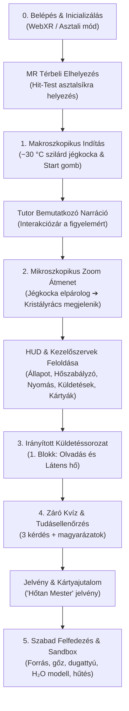

# FázisTér MR – Teljes Szimulációs Workflow

Ez a dokumentum lépésről lépésre, pontról pontra végigvezeti a felhasználó útját a **FázisTér MR** virtuális hőtani laboratórium teljes szimulációján: a rendszer indításától és az MR térbeli elhelyezéstől a pedagógiai küldetéseken, fázisátalakulásokon és kvízen át a szabad kísérletezésig.

---

## Áttekintő Folyamatábra (Workflow Overview)



---

## 0. Fázis: Indítás és Térbeli Elhelyezés (WebXR & Desktop)

### 0.1. Platformok és Megjelenítés
- **Meta Quest 3 (Fő mód – Kevert Valóság / MR):**
  - A Meta Quest Browserben a weboldal megnyitásakor megjelenik a lebegő Apple visionOS stílusú **„AR indítása”** kapszula gomb.
  - A gombra kattintva aktiválódik a WebXR `immersive-ar` munkamenet: a felhasználó látja a saját valós szobáját (passthrough nézet).
  - A rendszer Web Audio hangutasítással navigál (`01_ar_prompt.mp3`):  
    > *„Nézz egy asztalra vagy a padlóra! Ahol a fehér célzókarikát látod, oda érkezik a labor. Az elhelyezéshez húzd meg a ravaszt a kontrolleren, vagy kézkövetésnél érintsd össze a mutató- és hüvelykujjadat!”*
  - **Hit-Test asztalsík detektálás:** A kontrollerből vagy kézkövetéskor a mutatóujjal pásztázva egy fehér irányzék-gyűrű (retikül) követi az asztal/padló felületét.
  - Egy kattintással (ravasz meghúzása vagy mutató-hüvelykujj pinch) a teljes virtuális kísérleti asztal lehorgonyzódik a valós asztalfelületre a felhasználó felé fordulva.
  - Megerősítő hang (`02_ar_placed.mp3`):  
    > *„A laboratórium sikeresen elhelyezve. A labor állásának és méretének beállítása után nyomd meg a Start gombot a kezdéshez!”*
- **Asztali (Desktop Fallback) mód:**
  - Számítógépes böngészőben azonnal megjelenik a virtuális labor egy finom térbeli rács felett.
  - Az egér bal gombjával forgatható (OrbitControls), jobb gombbal tolható, görgővel zoomolható a nézet.

### 0.2. Térbeli Finomhangolás (Kontroller joystickok & ⚙ Beállítások)
- **Jobb kontroller hüvelykujj-kar (Thumbstick / Joystick):**
  - **Fel / Le (`🕹️ Jobb kar: ↕`):** A teljes virtuális modell/laboratórium méretének folyamatos növelése és csökkentése ($0.08\times .. 0.50\times$), a határértékeknél diszkrét haptikus impulzussal.
  - **Jobbra / Balra (`🕹️ Jobb kar: ↔`):** A teljes laboratórium folyamatos, sima elforgatása a talapzat középpontja körül ($0^\circ .. 360^\circ$).
- **Bal kontroller hüvelykujj-kar (Thumbstick / Joystick):**
  - **Fel / Le vagy Jobbra / Balra (`🕹️ Bal kar: ↕`):** A lebegő HUD felületek és információs panelek méretének folyamatos növelése és csökkentése ($60\% .. 160\%$).
- **Kezdő és Beállítások panelek:**
  - A lebegő kártyákon a csúszkák mellett közvetlen vizuális jelzések (`🕹️ Jobb kar: ↔`, `🕹️ Jobb kar: ↕`, `🕹️ Bal kar: ↕`) mutatják a kontroller-hozzárendeléseket, valamint gyorsgombok segítik a szembefordítást (`0° Szembe`), az alapméretet (`Alapméret`, `Alap HUD`) és az új asztalsík kijelölését (`📍 Új helyre rakás`).

---

## 1. Fázis: Makroszkopikus Kezdőállapot és Bemutatkozás

```
+-------------------------------------------------------------+
|                                                             |
|                   [ FázisTér MR ]                           |
|            Virtuális Hőtani Laboratórium                    |
|                                                             |
|   A kísérleti tartályban egy valódi, szilárd               |
|   jégkocka található (−30 °C). Indítsd el a bemutatót       |
|   a mikroszkópos kristályrács felfedezéséhez!               |
|                                                             |
|               [ ▶ Start / Bemutatkozás ]                    |
|                                                             |
+-------------------------------------------------------------+
```

1. **A kiinduló látvány:**
   - A hengeres kísérleti kamrában egy **valódi, rideg, fénytörő szilárd jégkocka** fekszik.
   - Hőmérséklete: **−30 °C**.
   - A jégkocka előtt egy nagy, jól olvasható, lebegő Vision Pro stílusú indítópanel áll.
   - A többi HUD panel (hőszabályzó, nyomás, küldetések, kártyák) még rejtve van, hogy a diák figyelmét ne forgácsolja szét a túl sok kezelőszerv.
   - A kamra mellett lebeg a 3D robot laborasszisztens (Tutor).

2. **A Start gomb aktiválása és a narráció:**
   - A tanuló a lézerrel rámutat a **`▶ Start / Bemutatkozás`** gombra és rákattint.
   - Az indítópanel eltűnik.
   - **Kattintászár (Focus Lock):** A beszéd alatt minden vezérlőfelület zárolva marad, így a diák a pedagógiai narrációra figyel.
   - A tutor feje és teste beszédanimációba kezd, és elhangzik a bevezető hanganyag (`03_welcome.mp3`):  
     > *„Üdvözöllek ebben az interaktív szimulációban! Amit magad előtt látsz, az a természet egyik legfontosabb anyaga: a víz. Jelenleg a szilárd formáját látod, de a hőmérséklet változtatásával ez az anyag lenyűgöző átalakulásokon tud keresztülmenni. A titok nyitja az energia. Kísérjük végig a vizet mind a három fő halmazállapotán, és nézzük meg, mi történik a színfalak mögött, mikroszkopikus szinten!”*

---

## 2. Fázis: A Mikroszkopikus Zoom Átmenet (Molekuláris szint)

1. **2.4 másodperces lágy mikroszkopikus átmenet:**
   - A hang végeztével elindul a vizuális zoom átmenet.
   - A makroszkopikus jégkocka finoman elpárolog/elhalványul.
   - A tartály belsejében láthatóvá válik a jég szilárd kristályrácsának modellje: halványan kirajzolódnak a molekulák közötti kötések, és a modell elülső részén sárga fénnyel kiemelkedik egy szabályos hatszögletű elrendezés (Ice Ih hatszöges szerkezet).
2. **A teljes munkatér feloldása:**
   - Megjelennek a lebegő HUD panelek a térben:
     - **Fent:** Dinamikus Állapotjelző (Halmazállapot jelvény, pillanatnyi hőmérséklet, nyomás, és a 3D forgó ⚙ Fogaskerék).
     - **Balra lent:** Hőszabályzó panel (vertikális láng/hűtés csúszka, gyorsgombok).
     - **Balra fent:** Tudáskártyák Gyűjteménye (kategóriákra bontott elméleti tudástár).
     - **Jobbra lent:** Nyomás- és Térfogatszabályzó (dugattyú pozíció, szelepállás).
     - **Jobbra fent:** Küldetés Panel (az aktuális feladat, tippek és a kvíz gomb – bemutatkozás után pulzáló aranysárga fókuszkerettel kiemelve).
3. **Első felhívás és a lebegő sárga felkiáltójel (`!`):**
   - A robot feje felett egy 3D lebegő, pulzáló aranysárga felkiáltójel (`!`) gyullad ki fényglóriával és pontfénnyel, míg a hasán lévő OLED kijelző is villogó sárga felkiáltójelre vált.
   - A Küldetés HUD aranysárga pulzáló kerettel és `👉 AKTUÁLIS KÜLDETÉS` szalaggal hívja fel magára a figyelmet.
   - Tutor felhívása (`04_intro_nav.mp3`):  
     > *„Nézd meg a jobb oldali Küldetés panelt a feladatokért, és az első küldetés megkezdéséhez kattints a felettem villogó sárga felkiáltójelre!”*

---

## 3. Fázis: Irányított Pedagógiai Küldetéssorozat (A Hőtani Folyamat Íve)

A tanuló nem magára hagyva kattintgat: a jobb felső panelen mindig az aktuális feladat olvasható (csendben, zavaró gépies felolvasás nélkül), míg a fizikai folyamatokat a kamrában kísérletezi ki. A felkiáltójel mindig a küldetés teljesítése után jelenik meg a robotnál az elméleti magyarázathoz.

```
       [ 1. Fázis: Szilárd jég & Jégkristály 3D modellje (Sárga felkiáltójel !) ]
                     │
       [ 2. Fázis: Felfűtés kis lánggal ➔ Melegedés közben folyamathang (09) ]
                     │
       [ 0 °C elérve: Láng automatikusan elalszik ➔ Sárga felkiáltójel ! ]
         └──► Elmélet: Olvadáspont, Plató és Olvadáshő (Lo = 334 kJ/kg)
                     │
       [ 3. Fázis: Fűtés a plató alatt a teljes olvadásig ]
                     │
       [ 100% jég elolvadt: Láng automatikusan elalszik ➔ Sárga felkiáltójel ! ]
         └──► Elmélet: Folyékony halmazállapot (0 °C-os víz)
                     │
       [ 4. Fázis: Felfűtés max lánggal ➔ Víz melegedése közben folyamathang (17) ]
                     │
       [ 100 °C és teljes elforrás elérve: Láng automatikusan elalszik ➔ Sárga felkiáltójel ! ]
         └──► Elmélet: Forráspont, Plató, Forráshő (Lf = 2260 kJ/kg) és Légnemű gőz
                     │
       [ 5. Fázis: Záró Kvíz & Hőtan Mester Jelvény ]
```

### 1. Fázis: A szilárd halmazállapot és a jégkristály 3D szerkezete
- **Cél:** A diák megértse a szilárd halmazállapot általános törvényszerűségeit (erős vonzóerők, merev rács, rácsrezgés) és a jég egyedi, hexagonális, tágas kristályszerkezetét (üres csatornák, amiért kisebb a sűrűsége a víznél és úszik a felszínen).
- **Küldetés a panelen (csendben):** *„Fedezd fel a szilárd halmazállapotot és a jégkristály 3D szerkezetét! Koppints a robot felkiáltójelére, és nézd meg felülről a modellt!”*
- **Esemény:**
  - A robot felett villog a sárga felkiáltójel (`!`).
  - Rákattintva a tutor elmondja az elméletet (`05_szilard_alapjai.mp3` és `07_kristalyszerkezet.mp3`).
  - Feloldódik a **`szilard`** és a Vision Pro 3 szekciós **`kristalyszerkezet`** tudáskártya.
  - A magyarázat után a felkiáltójel eltűnik, a Küldetés panel csendben átvált a fűtési feladatra.

### 2. Fázis: 1. Felfűtés és az Olvadáspont (0 °C, Olvadáshő)
- **Cél:** Annak megfigyelése, hogy melegítéskor −30 °C-tól 0 °C-ig a felvett hő a rácsrezgés sebességét növeli, de az anyag szilárd marad. 0 °C-nál pedig a felvett hő a kötések bontására fordul (**olvadáshő**, $L_o = 334\text{ kJ/kg}$), létrehozva a vízszintes hőmérsékleti platót!
- **Küldetés a panelen (csendben):** *„Állíts be kis lángot (20–30%) a bal panelen, és figyeld a jég melegedését!”*
- **Esemény:**
  - A tanuló 25%-ra állítja a lángot.
  - Melegedés közben megszólal a folyamathang (`09_melegedes_szilard.mp3`): *„Figyeld a részecskéket: a felvett hő hatására a molekulák rácsrezgése egyre gyorsul...”*.
  - Amint a jég eléri a 0 °C-ot, **a rendszer automatikusan lekapcsolja a fűtést (0%)**, így a jég stabilan 0 °C-os szilárd állapotban marad.
  - **A küldetés teljesült! A robot felett felvillan a sárga felkiáltójel (`!`)!**
  - Rákattintva a tutor elmondja az olvadáspont, a plató és az **olvadáshő** elméletét (`11_olvadaspont_es_olvadasho.mp3`).
  - Feloldódik az **`olvadaspont`**, a **`latens_ho`** és a **`plato`** tudáskártya.

### 3. Fázis: Teljes olvadás és a Folyékony víz (0 °C)
- **Cél:** A fázisátalakulás végigkövetése az utolsó jégkristály felbomlásáig, valamint a folyékony halmazállapot megismerése (a merev kötések megszűntek, a molekulák szabadon áramlanak egymáson, alakjuk változó, de térfogatuk állandó).
- **Küldetés a panelen (csendben):** *„Fűts tovább bátran (akár 100% lánggal), amíg az összes jég el nem olvad!”*
- **Esemény:**
  - A felkiáltójel eltűnik. A tanuló fűt. A hőmérséklet stabilan 0 °C marad, a jég folyékony vízzé olvad.
  - Amikor az utolsó kristály is elolvad (tiszta folyékony víz fázis elérve), **a rendszer automatikusan lekapcsolja a fűtést (0%)**, hogy a víz stabilan 0 °C-os maradjon.
  - **A küldetés teljesült! A robot felett felvillan a sárga felkiáltójel (`!`)!**
  - Rákattintva a tutor elmondja a folyékony állapot elméletét (`16_folyekony_alapjai.mp3`).
  - Feloldódik a **`viz_melegites`** tudáskártya.

### 4. Fázis: 2. Felfűtés, a Forráspont (100 °C, Forráshő) és a Légnemű gőz
- **Cél:** A víz felmelegítése 100 °C-ra, a forráspont elérése, a forrási látens hő (**forráshő**, $L_f = 2260\text{ kJ/kg}$) szerepének megértése és a légnemű halmazállapot törvényei (szabad száguldás, falnak ütközés adja a nyomást, további fűtésnél a gőz melegszik 100 °C fölé).
- **Küldetés a panelen (csendben):** *„Kapcsolj maximális lángot (100%), és figyeld a víz melegedését a forráspontig!”*
- **Esemény:**
  - A felkiáltójel eltűnik. A tanuló 100%-ra állítja a lángot.
  - A víz melegedése közben szól a kísérő hang (`17_melegedes_viz.mp3`): *„Figyeld: a folyékony víz melegszik! A részecskék egyre sebesebben kavarognak...”*.
  - 100 °C-on belép a forrási platóba, buborékok képződnek, a víz elforr.
  - Amikor az összes víz elforrt (100 °C-os tiszta gőz), **a rendszer automatikusan lekapcsolja a fűtést (0%)**.
  - **A küldetés teljesült! A robot felett felvillan a sárga felkiáltójel (`!`)!**
  - Rákattintva a tutor elmondja a forráshő és a légnemű gőz elméletét (`18_forraspont_es_forrasho.mp3` és `19_goz_alapjai.mp3`).
  - Feloldódik a **`forras`** és a **`goz`** tudáskártya.
  - A Küldetés panelen kigyullad a **„📝 Kvíz indítása”** gomb.
- **Cél:** A grafikon meredek felívelésének és a folyadék gyorsuló hőmozgásának megfigyelése.
- **Teendő:** A láng fenntartása, amíg a víz el nem éri az 50 °C-ot.
- **Esemény:** A plató után a grafikon újra meredeken emelkedik. A küldetéssorozat sikeresen teljesítve! A Küldetés panelen kigyullad a **„📝 Kvíz indítása”** gomb.

---

## 4. Fázis: Záró Kvíz és Tudásellenőrzés (Quiz)

A küldetések végeztével a tanuló azonnal ellenőrizheti tudását a 3D térben megjelenő interaktív kvíz felületen:

```
+-------------------------------------------------------------+
|  Kérdés 1/3:                                                |
|  Mi történik a hőmérséklettel, amíg a jég olvad (0 °C-on)?  |
|                                                             |
|  [ A ] Folyamatosan növekszik                               |
|  [ B ] Állandó marad (0 °C)          <-- [Helyes!]          |
|  [ C ] Csökken                                              |
|                                                             |
|  Magyarázat: A hőmérséklet állandó marad: ez a              |
|  hőmérsékleti plató a grafikonon!                           |
+-------------------------------------------------------------+
```

1. **A kvíz kérdései:**
   - **1. Kérdés:** *Miért kisebb a jég sűrűsége a folyékony víznél, ami miatt úszik a vízen?*  
     *(Helyes válasz: A hatszögletű kristályrácsban lévő tágas, üres csatornák miatt).*
   - **2. Kérdés:** *Mi történik a hőmérséklettel, amíg a jég olvad (0 °C-on)?*  
     *(Helyes válasz: Állandó marad 0 °C-on – hőmérsékleti plató).*
   - **3. Kérdés:** *Hogyan mozognak a részecskék a folyékony vízben a szilárd jéghez képest?*  
     *(Helyes válasz: Szabadon elgördülnek és áramlanak egymáson, felvéve az edény alakját).*
   - **4. Kérdés:** *Mi jellemző a légnemű (gőz) halmazállapotú anyagra?*  
     *(Helyes válasz: Nincs állandó alakja és térfogata: kitölti a teljes teret és összenyomható).*
2. **Azonnali pedagógiai visszajelzés:**
   - Minden gombnyomás után megjelenik a tudományos magyarázat, így a tanuló a hibáiból is tanul.
3. **Értékelés és jutalom:**
   - Sikeres kitöltés esetén (legalább 2 helyes válasz) feloldódik a rangos **`jelveny1`** (**🏅 Hőtan Mester**) gyűjteményi kártya!
   - A tanuló haladását és pontszámát a rendszer automatikusan elmenti a böngésző lokális memóriájába (`localStorage`).

---

## 5. Fázis: Szabad Kísérletezés, Fázisátmenetek és Haladó Funkciók (Sandbox)

A lecke teljesítése után a tanuló szabadon kísérletezhet a laborban határok nélkül:

### 5.1. Forrás és Gőzképződés (>100 °C)
- A lángot 100%-ra állítva a víz hőmérséklete eléri a **100 °C-ot**.
- Megjelenik a **Forrás** állapota: az edény alján és belsejében mikroszkopikus és makroszkopikus gőzbuborékok képződnek.
- Fellép a forrási látens hő (párolgáshő, 2260 kJ/kg).
- 100 °C felett a folyadék teljesen légnemű gőzzé alakul: a molekulák óriási sebességgel száguldanak és ütköznek a tartály falával.
- Automatikusan feloldódik a **`forras`** és a **`goz`** tudáskártya!

### 5.2. Visszahűtés és Fagyasztás (−100 °C)
- A bal oldali panelen a **„❄️ Fagyasztás (−100%)”** gombra kattintva a hűtőtalapzat jéghidegre vált.
- A forró gőz gyorsan lecsapódik, a folyékony víz lehűl 0 °C-ra, majd a látens hő leadásával újra szilárd, rendezett kristályrácsba fagy.

### 5.3. Nyomás és Térfogat (Dugattyú vezérlés)
- A jobb oldali panel csúszkájával vagy gombjaival mozgatható a felső mechanikus dugattyú.
- Zárt tér esetén a térfogat csökkentésével a nyomás megnő (Gay-Lussac és Boyle–Mariotte törvények szemléltetése).
- A nyomásmérő óra valós időben jelzi ki az atmoszférikus értéket (1.0 atm-től felfelé).

### 5.4. Kártyagyűjtemény és Kategóriák
- A bal felső panelen a tanuló böngészheti a megszerzett kártyákat négy kategóriában:
  - 🧊 **Halmazállapotok:** Szilárd halmazállapot, Jégkristály 3D modell, Folyékony víz, Légnemű gőz.
  - ⚡ **Változások:** Olvadáspont, Forráspont.
  - 🌡️ **Fogalmak:** Látens hő, Hőmérsékleti plató.
  - 🏅 **Jelvények:** Hőtan Mester kitüntetés.
- Bármelyik kártyára rákattintva egy felugró Vision Pro kártya jelenik meg, ami igény szerint hangosan fel is olvassa az anyagot.

### 5.5. Interakció a 3D Tutorral
- Ha a felhasználó kísérletezés közben bizonytalan, bármikor **rákattinthat a robot fejére**.
- A tutor ilyenkor kontextuális, véletlenszerű jótanácsot mond:
  - *„Próbáld meg elforralni a vizet a láng teljes feltekerésével!”*
  - *„Hűtéssel újra jégkristályokat kapsz!”*
  - *„A jobb oldali csúszkával nyomd össze a gázt a dugattyúval!”*
  - *„A felső fogaskerék ikonnal tetszőlegesen átméretezheted a HUD-ot vagy a labort!”*
  - *„Nézd meg a tudáskártyák gyűjteményét a bal felső panelen!”*

### 5.6. Rendszerbeállítások (⚙ 3D Fogaskerék)
- A felső állapotjelző mellett lassan forgó, elegáns 3D fogaskerékre kattintva nyitható meg a **Beállítások és Kalibráció panel**:
  - **Molekulamodell váltás:**
    - *Egyszerű gömb:* tiszta, letisztult részecskemodell.
    - *Valódi H₂O vízmolekula:* egy központi piros oxigén és két fehér hidrogén atom élethű, 104,5 fokos kötésszöggel!
  - **Térbeli pozicionálás:** HUD távolság, munkatér magasság és méretezés finomhangolása.
  - **Új asztalsík kijelölése:** ha a felhasználó átül egy másik székhez vagy asztalhoz.

---

## 6. Összegző Ellenőrzőlista (User Journey Checklist)

| Fázis | Lépés / Esemény | Felhasználói Cselekvés | Rendszer Reakció | Eredmény / Megszerzett Elem |
|---|---|---|---|---|
| **0.** | **MR Belépés** | Kattintás az „AR indítása” gombra | Passthrough aktiválódik, retikül megjelenik | Térbeli sík detektálása |
| **0.** | **Asztalra helyezés** | Rácélzás az asztalra + kattintás | Asztal lehorgonyzás, hangutasítás | Kísérleti labor a valós térben áll |
| **1.** | **Indítás** | Kattintás a `▶ Start` gombra | Interakciózár, bemutatkozó narráció | Fókuszált figyelem a felvezetésre |
| **2.** | **Mikroszkóp zoom** | Megfigyelés (2.4 mp) | Jégkocka elpárolog, kristályrács megjelenik | HUD panelek & (i) gomb feloldódnak |
| **3.1** | **Kristályrács** | Kattintás a tutor hasán lévő (i) gombra | Hangmagyarázat a hatszöges rácsról | 🧊 `szilard` kártya |
| **3.2** | **Kis láng** | Bal panel: „🔥 Kis láng (25%)” | Bunsen láng kigyullad, melegedés indul | Fűtés bekapcsolva |
| **3.3** | **Melegedés 0 °C-ig** | Hőmérséklet emelkedésének figyelése | Rácsrezgés gyorsul | Eléri a 0 °C-ot |
| **3.4** | **Olvadáspont** | Kattintás az (i) gombra 0 °C-on | Magyarázat az olvadáspontról | 📍 `olvadaspont` kártya |
| **3.5** | **Látens hő & Plató** | Kattintás az (i) gombra olvadás közben | Magyarázat a kötések bontásáról és a platóról | 🔥 `latens_ho`, 📈 `plato` kártyák |
| **3.6** | **Folyadékká olvadás**| Fűtés fenntartása (akár 100% láng) | Rács teljesen szétesik, folyékony víz | Víz fázis elérve |
| **3.7** | **0 °C-os víz** | Kattintás az (i) gombra | Magyarázat a folyadék melegítéséről | 💧 `viz_melegites` kártya |
| **3.8** | **Melegítés 50 °C-ra**| További fűtés | Hőmérséklet meredeken emelkedik | 1. Blokk küldetései kész! |
| **4.** | **Kvíz teszt** | 3 kérdés megválaszolása | Azonnali magyarázat minden kérdésre | 🏅 `jelveny1` („Hőtan Mester”) jelvény |
| **5.** | **Sandbox & Bővítés**| Forralás 100 °C fölé, hűtés, dugattyú | Gőzbuborékok, gáz nyomás, fagyás | 🫧 `forras`, 💨 `goz` kártyák, szabad kutatás |
